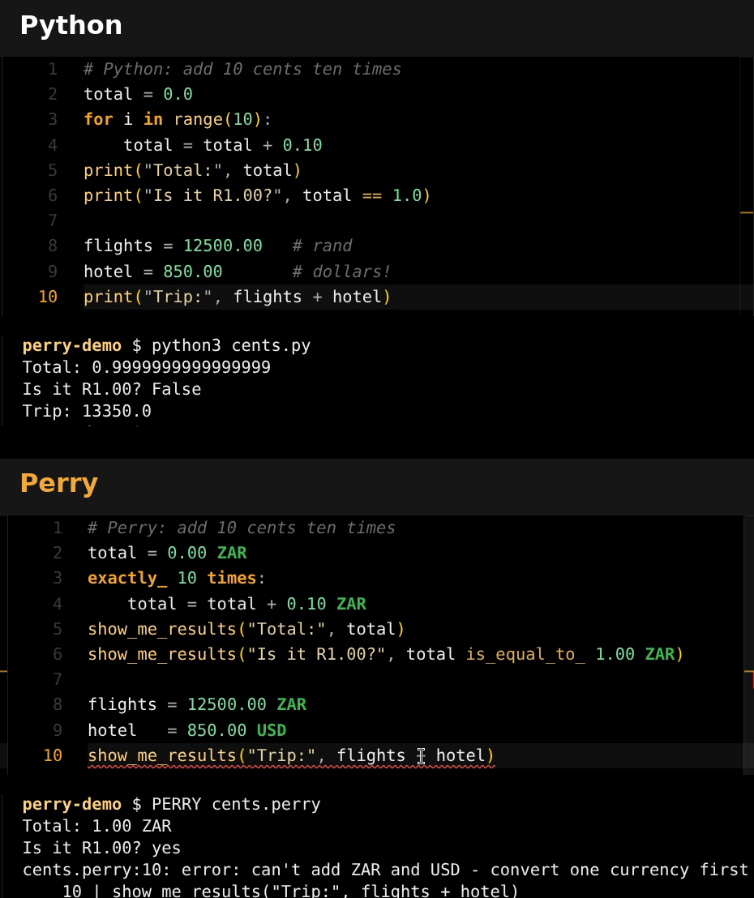
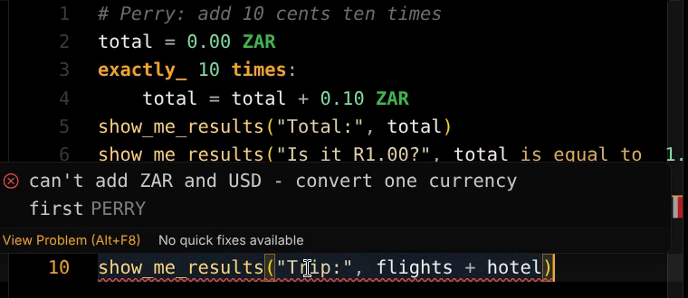
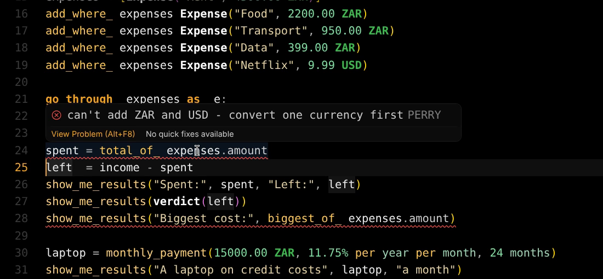

<p align="center">
  
</p>

<h1 align="center">Perry</h1>

<p align="center">
  <b>A programming language for money that reads like English.</b><br>
  Exact to the cent. Knows its currencies. Finds money mistakes before the program runs.
</p>

<p align="center">
  <a href="https://mzwesh-1.github.io/perry/">Read the article</a> ·
  <a href="docs/media/perry-demo.mp4">Watch the 3-minute demo</a> ·
  <a href="docs/LANGUAGE.md">Language reference</a> ·
  <a href="docs/press">Press kit</a> ·
  <a href="#quick-start">Quick start</a>
</p>

<p align="center">
  
  
  
  
</p>

---

Most programming languages store money as binary floating-point numbers, which
cannot represent everyday amounts such as 10 cents exactly, and they have no idea
that rand and dollars are different things. Perry is built for money from the
ground up. It was created in South Africa by **Mzwandile Zulu**.

```perry
salary = 25000.00 ZAR
rent   = 7800.00 ZAR
never_changes_ VAT = 15%

check_if_ rent is_greater_than_ 40% of salary:
    show_me_results("Rent is too high!")
thats_if_ rent is_similar_to_ 30% of salary within_ 500.00 ZAR:
    show_me_results("Rent is just right")
since_then_:
    show_me_results("Rent is affordable")

shares = split 100.00 ZAR into 3
show_me_results("R100 split three ways:", shares)
show_me_results("VAT on a R999 phone:", vat_on_ 999.00 ZAR)

savings = 20% of (salary - rent)
because_is_ savings
```

```text
Rent is just right
R100 split three ways: [33.34 ZAR, 33.33 ZAR, 33.33 ZAR]
VAT on a R999 phone: 149.85 ZAR
savings is 3440.00 ZAR
  because savings = 20% of (salary - rent)
                  = 20% of (25000.00 ZAR - 7800.00 ZAR)
  salary is 25000.00 ZAR (given)
  rent is 7800.00 ZAR (given)
```

The three-way split always adds back up to exactly R100, and `because_is_` shows
how every answer was worked out.

## Why Perry?

### 1. Exact money

Perry has no floating point. Every number is an exact decimal (up to 18 digits
before the point and 12 after), and money is always rounded to its currency's
decimal places: 2 for ZAR and USD, 0 for JPY, 3 for KWD.

| | Python | Perry |
|---|---|---|
| Add 10 cents ten times | `0.9999999999999999` | `1.00 ZAR` |
| Is that equal to R1.00? | `False` | `yes` |
| R12 500 + $850 | `13350.0`, no warning | stops: *can't add ZAR and USD - convert one currency first* |

<p align="center">
  
</p>

Both programs are in [`examples/showcase`](examples/showcase).

### 2. It knows currencies and rates

Amounts carry their currency (`199.99 ZAR`, `9.99 USD`), and interest rates carry
their period (`11.75% per year`). Perry refuses sums that make no financial sense:

- adding rand to dollars without an exchange rate
- adding a plain number to money
- using a yearly rate where a monthly one is needed
- converting with an exchange rate for the wrong currencies

To mix currencies, convert explicitly. The rate then shows up in `because_is_`:

```perry
netflix = convert_ 9.99 USD to_ ZAR at_rate_ 18.20 ZAR per USD
```

### 3. It finds mistakes before the program runs

`PERRY --check` reads a program without running it and reports every money
mistake it can prove, on **every** path, including `check_if_` branches and
functions that a test run never reaches:

```perry
define_ year_end(balance, is_december):
    check_if_ is_december:
        give_back_ balance + 250.00 USD
    give_back_ balance

show_me_results(year_end(10000.00 ZAR, no_))
```

Running this prints `10000.00 ZAR`, because the December branch never runs.
`--check` still finds the bug:

```text
year_end.perry:3: error: can't add ZAR and USD - convert one currency first
```

In VS Code, the check runs every time you save, and mistakes are underlined in red:

<p align="center">
  
</p>

The checker only reports what it can prove. In our tests it raised **no false
alarms** on correct programs (including 900 randomly generated ones), and
it caught **98% of deliberately introduced money mistakes** before the programs
were run. A study with programs written by university students is planned. See
[`research/`](research) to reproduce every number.

### 4. Finance is built in

| Area | What you get |
|---|---|
| Everyday money | `split ... into`, `vat_on_`, `vat_inside_`, `round_to_ ... the_bank_way_`, tax tables |
| Loans and interest | `monthly_payment`, `schedule_of_`, `compound_interest_`, `future_value_`, `present_value_` |
| Investment appraisal | `npv_`, `irr_`, `payback_`, `discounted_payback_` |
| Depreciation | `straight_line_`, `reducing_balance_`, `sum_of_years_` |
| Annuities and bonds | `annuity_`, `annuity_due_`, `perpetuity_`, `bond_price_`, `bond_yield_` |
| Statistics (exact fractions) | `average_of_`, `median_`, `variance_`, `standard_deviation_`, `correlation_`, `regression_` |
| Actuarial | life tables, `life_expectancy_`, `life_annuity_`, `term_insurance_`, `endowment_` |
| Data | CSV bank statements, filters, sorting, `group_by_`, `duplicate_where_`, `save_to_` |
| Bookkeeping | `book_` entries that must balance, `balance_of_`, `trial_balance_()` |
| Dates | `+ 5 business days` that skip South African public holidays, `end_of_month_` |

The finance functions were checked against an independent 60-digit reference on
more than 40 000 random cases, with 0 differences.

## Build an app in 30 lines

[`examples/showcase/budget_app.perry`](examples/showcase/budget_app.perry) is a
student budget planner that uses records (`blueprint_`), functions, user input,
lists and a loan calculation:

```perry
blueprint_ Expense:
    name:   text
    amount: money

income = ask_user_("What is your monthly income?") as_ ZAR

expenses = [Expense("Rent", 4500.00 ZAR)]
add_where_ expenses Expense("Food", 2200.00 ZAR)
add_where_ expenses Expense("Transport", 950.00 ZAR)

spent = total_of_ expenses.amount
show_me_results("Spent:", spent, "Left:", income - spent)

laptop = monthly_payment(15000.00 ZAR, 11.75% per year per month, 24 months)
show_me_results("A laptop on credit costs", laptop, "a month")
```

Add a Netflix bill in dollars, and Perry flags it on save before the app ever runs:

<p align="center">
  
</p>

## Quick start

Perry is written in plain C99 with no dependencies.

**Linux, macOS or Windows (WSL):**

```sh
git clone https://github.com/mzwesh-1/perry.git
cd perry
make
./PERRY examples/showcase/english.perry
sudo make install          # optional: lets you type PERRY anywhere
```

**Windows (without WSL):** install a C compiler such as MinGW-w64, then run
`build.bat`.

Ready-built programs for Linux, Windows and macOS are made on every push: open
the [Actions tab](../../actions), choose the latest run, and download them under
*Artifacts*.

Other commands:

```sh
PERRY program.perry            # run a program
PERRY --check program.perry    # find money mistakes without running
PERRY --tokens program.perry   # what the lexer sees
PERRY --tree program.perry     # what the parser builds
PERRY --version
make test                      # run the checker's tests
```

## Keywords at a glance

Perry's keywords end with an underscore, so they never clash with your own names.

| Perry | Meaning |
|---|---|
| `check_if_` / `thats_if_` / `since_then_` | if / else if / else |
| `is_greater_than_`, `is_less_than_`, `is_equal_to_` | comparisons |
| `is_similar_to_ ... within_ ...` | close enough, within a tolerance |
| `exactly_ 10 times:`, `keep_going_while_`, `go_through_ list as_ item:` | loops |
| `define_ name(a, b):` ... `give_back_` | functions |
| `blueprint_ Payment:` | records with typed fields |
| `never_changes_ VAT = 15%` | a constant |
| `not_unless_ ...` | stop if a requirement isn't met |
| `try_this_:` ... `even_if_ theres_a_currency_error_:` | error handling |
| `steal_from_ budget_tools` | use another Perry file |
| `because_is_ name` | explain how a value was calculated |

The full list, with examples, is in the [language reference](docs/LANGUAGE.md).

## Project layout

| Path | Contents |
|---|---|
| `src/` | the interpreter (lexer, parser, exact decimal arithmetic, finance library) and the `--check` static checker |
| `examples/` | example programs; `examples/showcase/` has the programs from the demo video |
| `tests/check/` | tests for the checker (`make test`) |
| `research/` | scripts that reproduce every evaluation number, and the student bug-study kit |
| `docs/` | the [article](https://mzwesh-1.github.io/perry/), the language reference, figures, the demo video and the [press kit](docs/press) |

## Status

Perry 0.9.0 is a working interpreter and checker, used for teaching finance and
programming. The language is still young: expect new features and occasional
changes. Bug reports and ideas are welcome in [Issues](../../issues).

## Licence

Perry is free and open source under the [MIT licence](LICENSE).
Copyright © 2026 Mzwandile Zulu.
